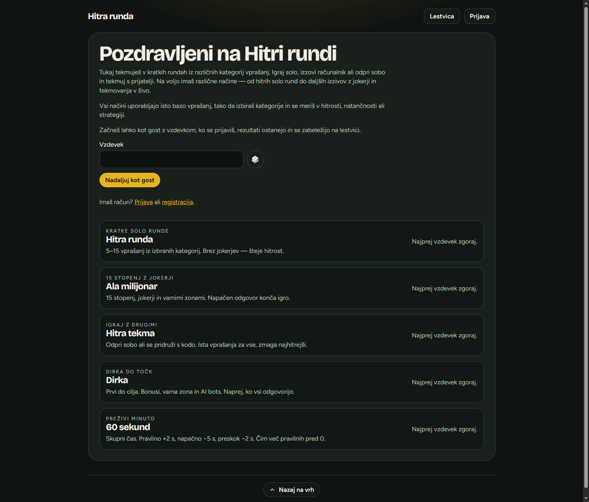
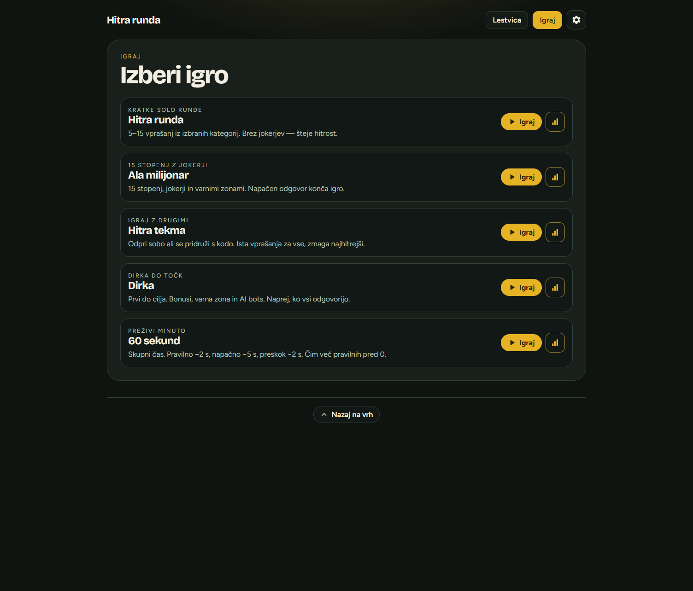
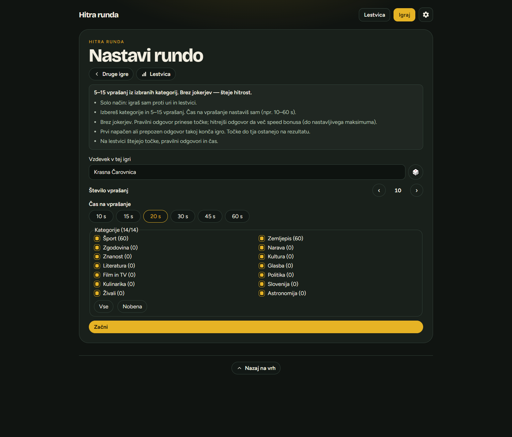
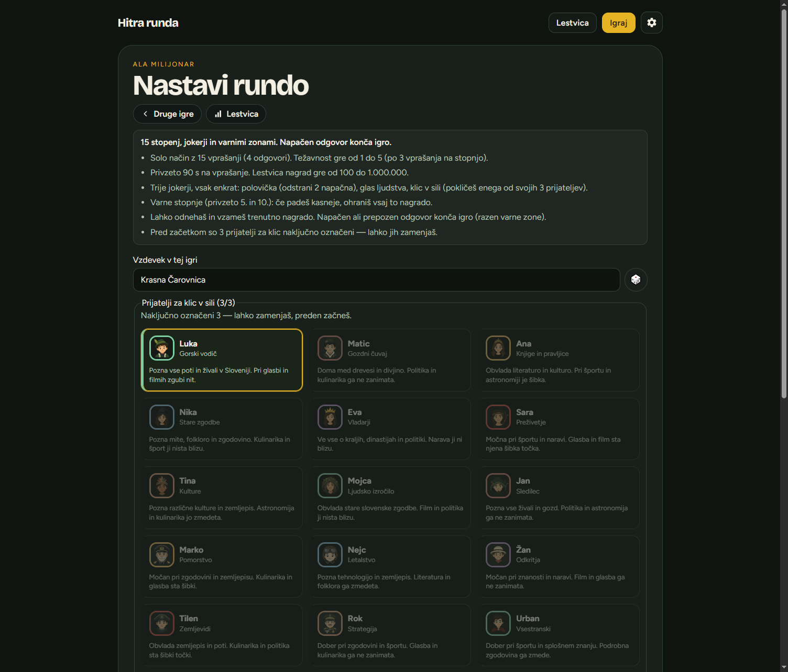
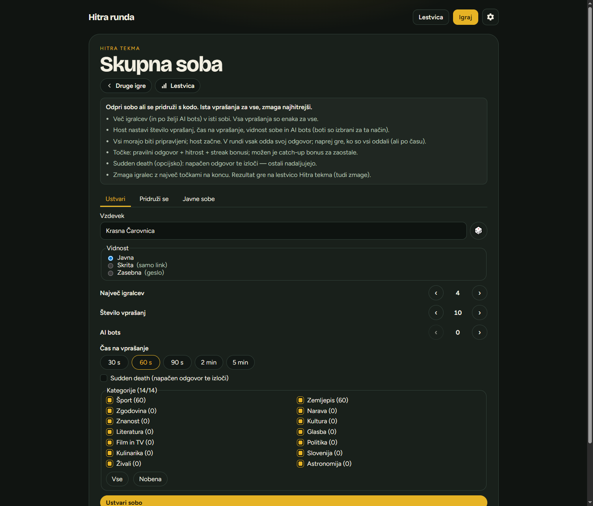
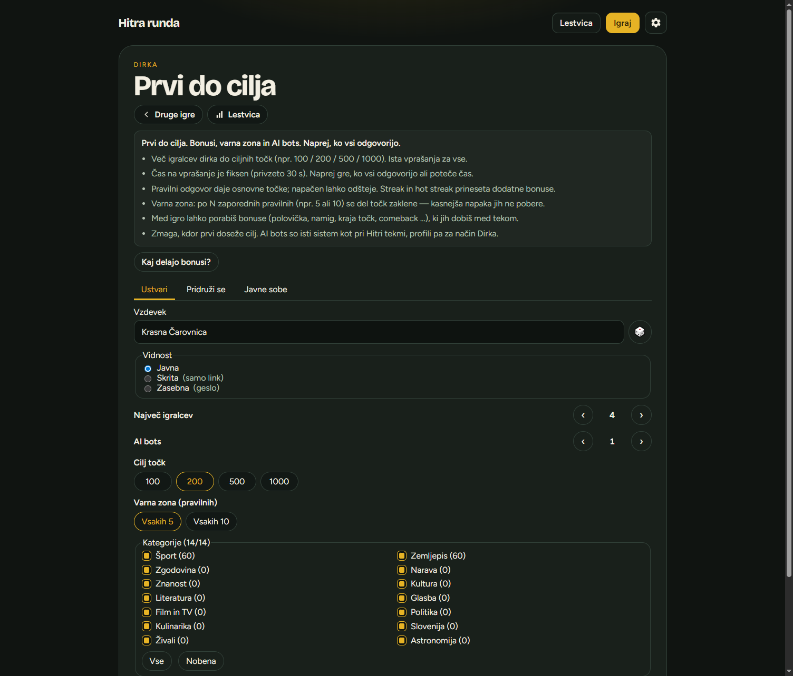
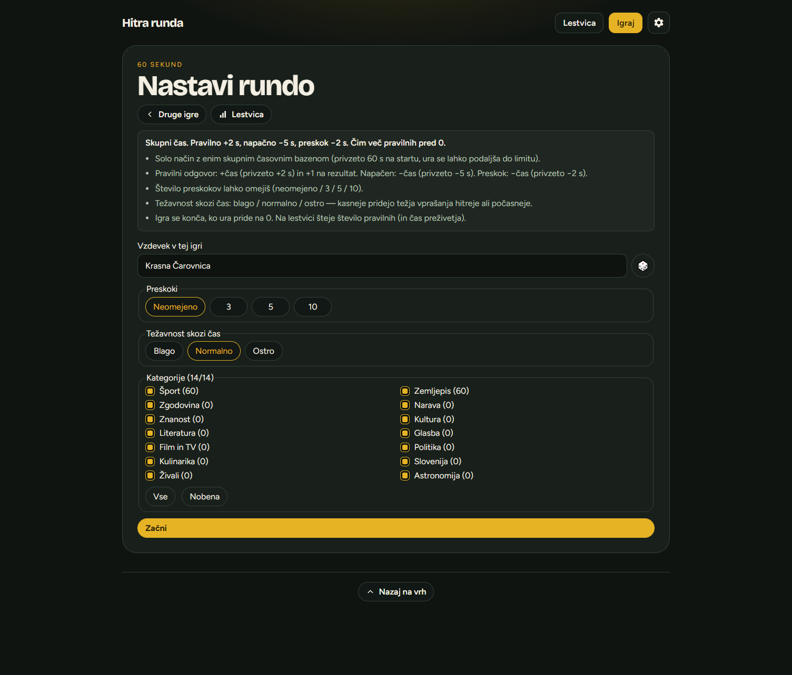

# Hitra runda

Spletna kviz igra v slovenščini. Igraš solo ali z drugimi, izbiraš kategorije in se meriš na lestvici.

Začetek je možen kot gost z vzdevkom; z računom rezultati ostanejo na profilu in javni lestvici.

**Alpha 0.2**



## Izberi igro

Po prijavi (ali kot gost) odpreš seznam načinov. Vsak način ima lastno nastavitev, pravila in lestvico.



## Načini igre

### Hitra runda

Kratke solo runde. Izbereš kategorije, število vprašanj (5–15) in čas na vprašanje. Brez jokerjev — šteje hitrost. Prvi napačen ali prepozen odgovor konča igro; točke do tja ostanejo na rezultatu.



### Ala milijonar

15 stopenj z naraščajočo težavnostjo, jokerji (polovička, glas ljudstva, klic v sili) in varnimi zonami. Napačen odgovor konča igro (razen varne stopnje). Pred začetkom izbereš 3 prijatelje za klic.



### Hitra tekma

Več igralcev v sobi (po želji z AI boti). Odpreš sobo ali se pridružiš s kodo. Ista vprašanja za vse; točke iz pravilnosti, hitrosti in streakov. Opcijsko sudden death. Zmaga igralec z največ točkami.



### Dirka

Dirka do ciljnih točk (npr. 100 / 200 / 500 / 1000). Bonusi, varna zona in AI boti. Naprej gre, ko vsi odgovorijo (ali poteče čas). Zmaga, kdor prvi doseže cilj.



### 60 sekund

Solo način z enim skupnim časovnim bazenom. Pravilno +čas, napačno −čas, preskok −čas. Cilj: čim več pravilnih, preden ura pride na 0. Nastaviš preskoke in težavnost skozi čas.



## Tehnologije

- **Frontend:** React, TypeScript, Vite
- **Backend:** Django, Django Channels (WebSocket)
- **Podatki:** PostgreSQL, Redis
- **Zagon:** Docker Compose

## Hitri zagon

Potrebuješ Docker in Docker Compose.

```bash
cp .env.example .env   # po želji prilagodi
docker compose up --build
```

Aplikacija teče na [http://localhost:5008](http://localhost:5008) (ali `APP_PORT` iz `.env`).

Privzeti admin (samo za razvoj):

- e-pošta: `admin@hitrarunda.local`
- geslo: `admin12345`

## Produkcija (HTTP ali HTTPS)

Potrebuješ Docker. Nastaviš eno `.env` datoteko in zaženeš en ukaz.

```bash
cp .env.prod.example .env
# uredi: APP_URL, gesla, DJANGO_SECRET_KEY
chmod +x deploy/install.sh

# HTTP (npr. LAN / IP:port)
./deploy/install.sh http

# ali HTTPS (domena + Let's Encrypt)
# APP_URL=https://igra.primer.si
# APP_DOMAIN=igra.primer.si
# TLS_EMAIL=admin@primer.si
./deploy/install.sh https
```

Na Windowsu: `.\deploy\install.ps1 http` ali `.\deploy\install.ps1 https`.

| | HTTP | HTTPS |
| --- | --- | --- |
| `APP_URL` | `http://IP:5008` | `https://domena.si` |
| Port | `APP_PORT` (privzeto 5008) | 80 + 443 |
| TLS | ne | Caddy + Let's Encrypt |

`APP_URL` sam nastavi dovoljene hoste, CSRF in varne piškotke. Dodatni `DJANGO_*` overridei so opcijski.

## Struktura

```
backend/     Django API, igralni motorji, WebSocket
frontend/    React odjemalec
deploy/      Produkcijski install (HTTP/HTTPS)
docs/        Dokumentacija in posnetki zaslona
questions.json   Vsebina vprašanj (uvoz prek admina)
```

## Admin

Staff uporabniki imajo nadzorno ploščo za vprašanja, kategorije, bonuse, bote, sobe, seje in uporabnike.

## Licenca

Zasebni projekt — glej lastnika repozitorija glede uporabe.
